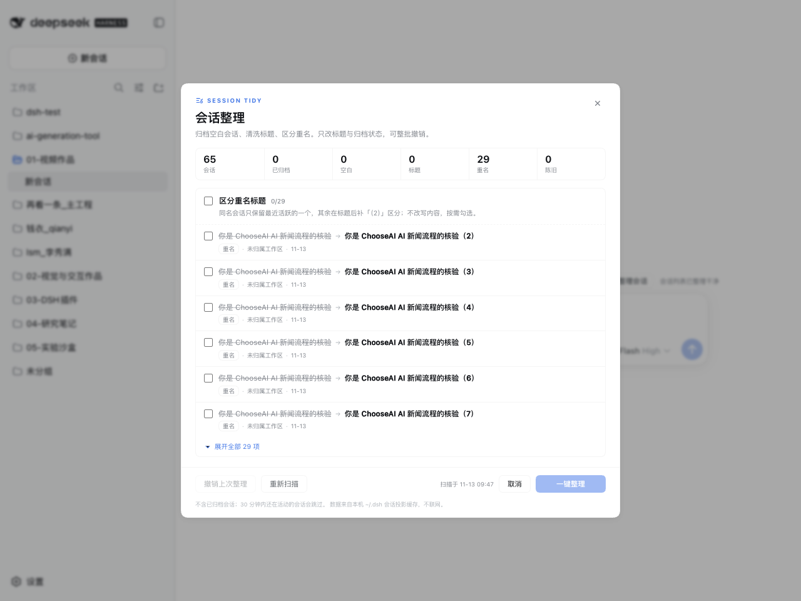

# dsh-session-tidy — Session Tidy

A real, installable [DeepSeek Harness](https://github.com/deepseek-ai/deepseek-harness) plugin that **tidies the sidebar session list in one click**.

A resident “整理会话” chip sits just above the composer. It opens a preview sheet of proposed changes — archive blank sessions, rewrite truncated or instruction-prefixed titles, disambiguate duplicates, optionally archive stale sessions — and applies the selected ones in one action. Every batch can be undone.



## What it tidies

| Rule | Action | Default |
|---|---|---|
| **Blank sessions** — never received a prompt (`blank` projection, or 0 turns with no first prompt) | archive (never delete) | ✅ on |
| **Title cleanup** — strips “you are a …” role preambles, code fences, URLs, newlines and truncation ellipses; caps at 30 display columns | rename | ✅ on |
| **Duplicate titles** — keep the most recently active one, suffix the rest with （2） | rename | ⬜ off |
| **Keep newest N per workspace** (3/5/8/12, default 5) — archive the tail of each registered workspace | archive | ✅ on |
| **Stale sessions** — no activity for N days (1/3/7/14/30/90, default 7) | archive | ✅ on |

Safety rails: archived, pinned, running and subagent-owned sessions are skipped; the session you have open and anything active within 5 minutes are skipped; at most 40 renames per run; the last five batches are recorded in `data/undo.json` for one-click undo.

## Install

Requires DSH `>= 0.2.0`, Node `>= 20`.

```sh
dsh plugin --profile <profile> add link:/absolute/path/dsh-session-tidy
```

Then restart DSH Desktop (the Host half loads at boot). The Web half alone can be refreshed.

## Data & privacy

Reads `~/.dsh/storages/session_projcache/sessions/*.json` (titles, first prompts, turns, blank flag, last prompt time) and `~/.dsh/storages/workspace.json` (workspace membership, archived/pinned state). No network, no model calls. Writes happen only after you press the primary action, and only touch titles and archive markers.

## HTTP surface

| Path | Method | Purpose |
|---|---|---|
| `/session-tidy-api/status` | GET | health, caches, last apply |
| `/session-tidy-api/plan` | GET | tidy plan (`?refresh=1` bypasses the 10 s cache) |
| `/session-tidy-api/apply` | POST | `{batchId?, actions:[…]}` |
| `/session-tidy-api/undo` | GET/POST | undo ledger / undo last batch |

Mutations go through `sessionController.rename()` and `workspaceRegistry.archiveSession()`.

Access control: prefix routes bypass DSH's Connection admission, so every request goes through
`ctx.connection.requestRejection(req)` (Host/Origin checks plus the browser credential) and is
rejected with 401/403 when that fails; writes additionally require
`content-type: application/json` and an `x-dsh-session-tidy: 1` header, which a cross-origin page
cannot forge without a CORS preflight.

## Development

```sh
node build.mjs
node verify/plan.test.mjs && node verify/routes.test.mjs && node verify/client.test.mjs
```

Host-side changes require a DSH restart (ESM caching). See `STATUS.md` for the verification record and `README.zh-CN.md` for the full Chinese documentation.
