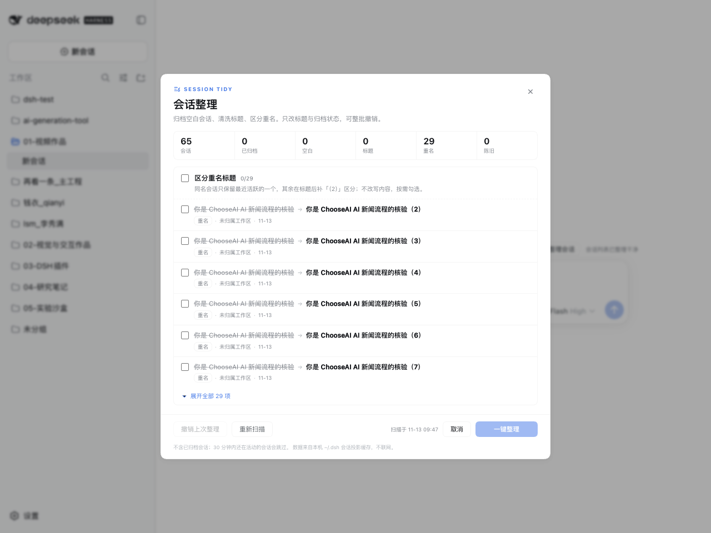

# dsh-session-tidy — 会话整理

一个真实可装的 [DeepSeek Harness](https://github.com/deepseek-ai/deepseek-harness) 插件：**一键整理侧栏的会话列表**。

入口常驻在**输入框上方**：点「整理会话」，浮层里预览整理建议，一次应用，整批可撤销。



## 它整理什么

| 规则 | 动作 | 默认 |
|---|---|---|
| **归档空白会话**：从未输入过提示词的会话（投影缓存 `blank` 或 0 轮次且无首条提示词） | 归档，不删除 | ✅ 勾选 |
| **整理标题**：去掉「你是一个/你是一位…」角色设定开头、代码块、URL、换行与截断省略号，压到 30 字以内 | 重命名 | ✅ 勾选 |
| **区分重名**：同名会话只留最近活跃的一个，其余在标题后补「（2）」，不改写内容 | 重命名 | ⬜ 按需勾选 |
| **每个工作区保留最近 N 条**（N 可选 1/3/5/8/12，默认 5；1 = 只留当前会话）：在每个工作区内按最后活动时间排序，排在后面的收进归档 | 归档，不删除 | ✅ 勾选 |
| **归档陈旧会话**：超过 N 天没有活动的会话（1/3/7/14/30/90 天可选，默认 7） | 归档，不删除 | ✅ 勾选 |

安全边界：

- 已归档、已置顶、正在运行（`openStep` 存在）、以及**子代理会话**一律跳过；
- **当前打开的会话与 5 分钟内还在活动的会话不碰**；
- 单次整理最多 40 条改名，其余留到下一批；
- 「保留最近 N 条」只作用于 `workspace.json` 里登记过的工作区，未归属的散会话不碰；
- 每批动作写进 `data/undo.json`，保留最近 5 批，浮层里一键「撤销上次整理」。

## 安装

要求：DeepSeek Harness `>= 0.2.0`（桌面版 0.2.2 核对）、Node `>= 20`。

```sh
# 本地目录（本仓已在 desktop profile 装好这一条）
dsh plugin --profile <profile> add link:/绝对路径/dsh-session-tidy

# 或直接改 profile：package.json 的 dependencies 加 link，bundles 加 dsh-session-tidy
```

装好后**重启一次 DSH Desktop**（Host 半边在启动时加载；只改 Web 半边时刷新页面即可）。

> 桌面版的 profile 由应用独占管理；本仓的安装方式是写 `~/.dsh/profiles/desktop/package.json` 后用 pnpm `link:` 安装，再重启应用。

## 数据来源与隐私

| 数据源 | 用途 |
|---|---|
| `~/.dsh/storages/session_projcache/sessions/*.json` | 标题、首条提示词、轮次、空白标记、最近提示时间 |
| `~/.dsh/storages/workspace.json` | 工作区归属、归档与会话置顶状态 |

- 只读本机文件，不联网、不调用任何模型；
- 标题是**确定性清洗**，不是语义总结——改完长什么样，预览里逐条可见；
- 写入只发生在你点「一键整理」之后，且只改标题与归档标记。

## 本地 HTTP 接口

Host 半边在 DSH 自带 webServer 上注册同源前缀路由，供 Web 半边调用：

| 路径 | 方法 | 说明 |
|---|---|---|
| `/session-tidy-api/status` | GET | 插件健康状态、缓存状态、上次整理结果 |
| `/session-tidy-api/plan` | GET | 整理建议（`?refresh=1` 跳过 10 秒缓存） |
| `/session-tidy-api/apply` | POST | `{batchId?, actions:[{kind:'rename'\|'archive'\|'unarchive', sessionId, title?}]}` |
| `/session-tidy-api/undo` | GET | 撤销账本摘要（最近 5 批） |
| `/session-tidy-api/undo` | POST | 撤销最近一批 |

写操作走宿主服务：`sessionController.rename()` 与 `workspaceRegistry.archiveSession()` / `unarchiveSession()`。

## 开发

```bash
cd "03-DSH插件/dsh-session-tidy"
node build.mjs            # 构建 lib/client.js（零依赖，产物可 node --check）
node verify/plan.test.mjs # 规则单测
node verify/routes.test.mjs
node verify/client.test.mjs
```

改 Host 代码后必须重启 DSH（Node ESM 按 URL 缓存）；只改 `src/runtime/` 时重跑 build 并刷新页面。

诊断通道：插件激活时写 `data/status.json`（phase / dataRoot / 最近 apply / 错误）与 `data/plugin.log`。

## 已知限制

- 不做语义总结：标题只从首条提示词做确定性清洗，长句仍可能偏长；
- 「重名」只补序号，不推断主题；
- 撤销只覆盖最近 5 批，且只有动作执行成功的条目会进账本；
- 改名需要宿主 resume 会话，批量改名会逐条进行（浮层里显示进度，每 6 条一次请求）。
